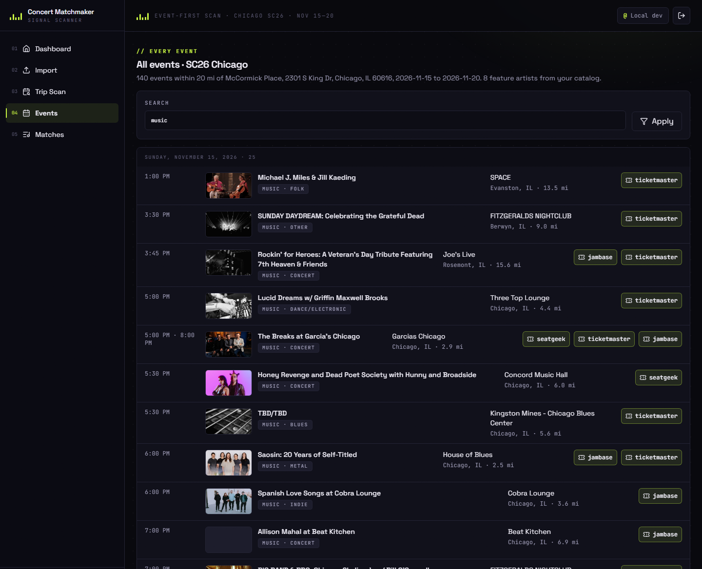
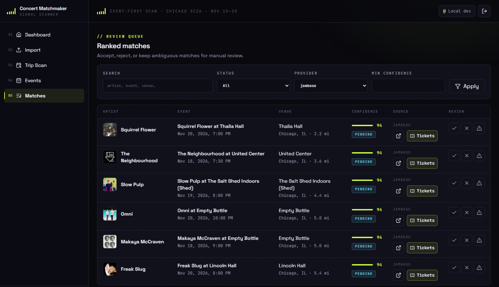
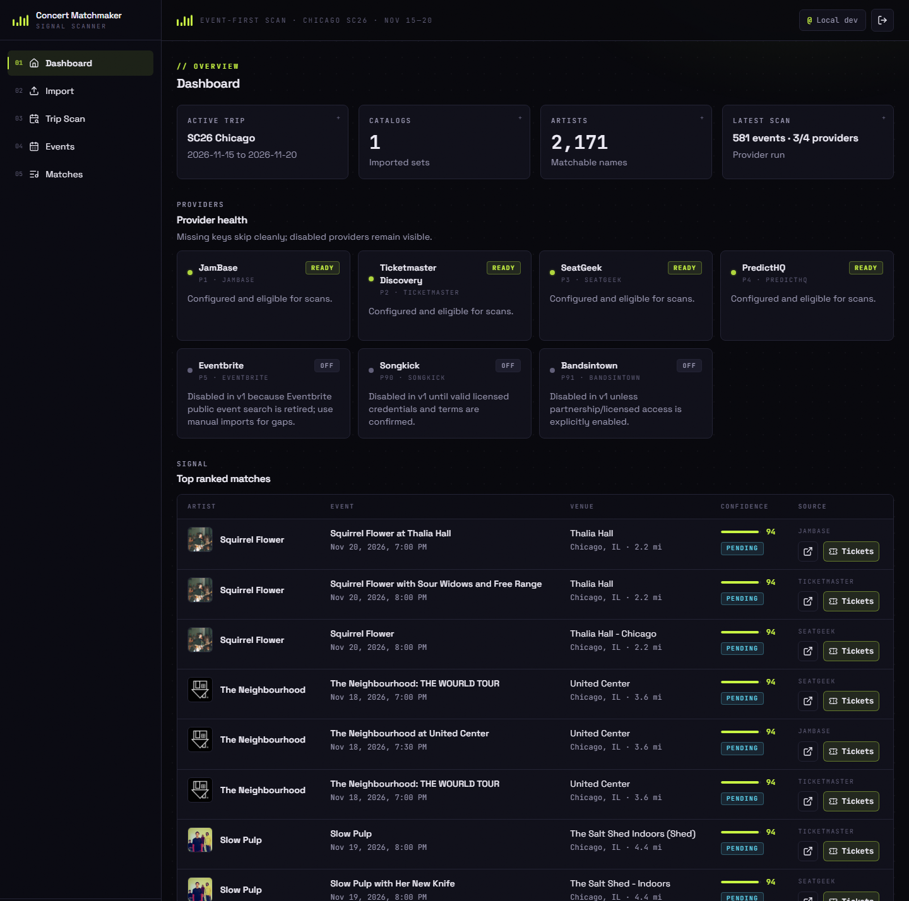
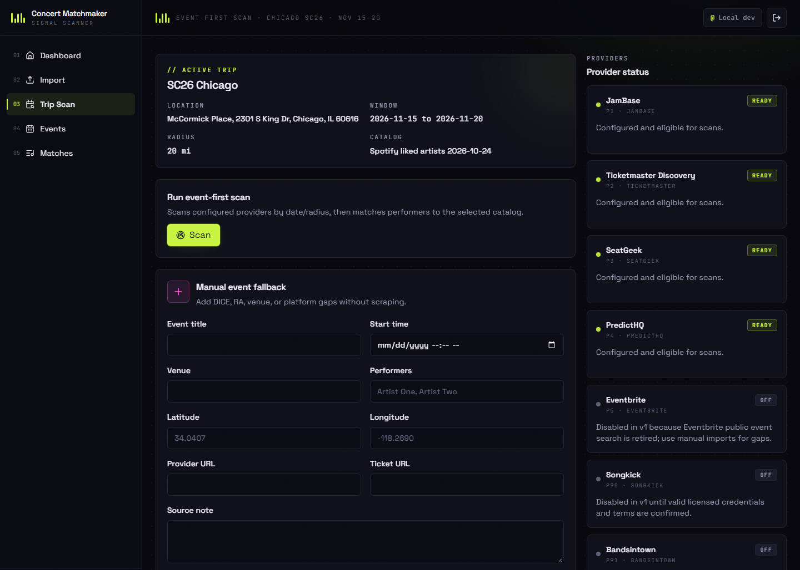

<p align="center">
  
</p>

<h1 align="center">Concert Matchmaker</h1>

<p align="center">
  <em>You land for a conference. Your favorite band plays two blocks away. You find out on the flight home.<br>Not anymore.</em>
</p>

<p align="center">
  
  
  
  
  
</p>

<p align="center">
  <strong>2,914 liked songs &middot; 2,171 artists &middot; 581 listings scanned &middot; 271 events &middot; 6 shows worth leaving the hotel for</strong><br>
  <sub>One real run: SC26 in Chicago, Nov 15–20 2026, 20 miles around McCormick Place, Ticketmaster + SeatGeek + JamBase. Every performer and every name in every event title checked against every artist in the Spotify library.</sub>
</p>

---

<p align="center">
  
</p>

Concert Matchmaker reads the artists behind your Spotify Liked Songs and checks them against every event the ticketing sites list, for the exact days and the exact radius you'll be somewhere. It is event-first: it pulls the whole city's calendar, then asks which of those performers you already love.

## Before / after

Before: four tabs of Ticketmaster, one of SeatGeek, Spotify open in another window, and a growing suspicion you missed something.

After:

```bash
curl -X POST localhost:3001/api/scans   # every provider, every event, matched
```

Then open `/matches`.

## Screens

<table>
  <tr>
    <td width="50%"></td>
    <td width="50%"></td>
  </tr>
  <tr>
    <td><strong>Matches</strong>: your artists, the show, how sure the match is, and where to buy.</td>
    <td><strong>Dashboard</strong>: trip, catalog, last scan and provider health at a glance.</td>
  </tr>
  <tr>
    <td></td>
    <td></td>
  </tr>
  <tr>
    <td><strong>Trip Scan</strong>: run a scan, or add a show the APIs don't know about.</td>
    <td><strong>Events</strong>: everything in town, not only the matches. Search <code>music</code> to narrow it.</td>
  </tr>
</table>

## How it works

```
1. Export your liked artists   → CSV or JSON, one artist per row, Spotify IDs if you have them
2. Import the catalog          → names normalized, aliases and duplicates folded
3. Scan the trip window        → every provider with a key, by date and radius
4. Fold the noise              → one row per show: cross-provider twins and time slots merged
5. Match performers            → shared Spotify ID, exact name, alias, then a guarded fuzzy pass
6. Review                      → accept, reject, or keep the ambiguous ones
```

Event-first means the scan never misses a show because you forgot to search for the band. Matching is strict on purpose: an exact or alias match scores 90–100, and anything fuzzier lands as `ambiguous` for you to decide instead of being guessed.

## Providers

| Provider | What it brings | Needs |
|---|---|---|
| Ticketmaster Discovery | Arenas, theaters, most mid-size rooms; event images | `TICKETMASTER_API_KEY` |
| SeatGeek | Second marketplace, extra listings and resale | `SEATGEEK_CLIENT_ID` (+ secret) |
| JamBase | Club shows with full lineups | `JAMBASE_API_KEY` |
| PredictHQ | Concerts, festivals and performing arts as a cross-check | `PREDICTHQ_ACCESS_TOKEN` |
| Eventbrite, Songkick, Bandsintown | Off by default until licensed access exists | see `.env.example` |

A missing key is a skipped provider, never a crash. Shows sold only through DICE, Tixr or a venue's own site can be added by hand from Trip Scan.

## Quick start

```bash
pnpm install
cp .env.example .env.local        # DATABASE_URL at minimum, provider keys as you get them
pnpm prisma:migrate
pnpm prisma:seed                  # creates the default trip from lib/trips.ts
pnpm dev --hostname 127.0.0.1 --port 3001
```

Set `DEV_AUTH_BYPASS=true` to skip GitHub sign-in locally (ignored in production). Import your artists from `/import`, hit **Scan** on `/trips`, read `/matches`.

Import accepts CSV or JSON with an `artist_name` / `name` column, plus optional `spotify_id` and `liked_track_count`. See [`fixtures/sample-artists.json`](fixtures/sample-artists.json). After importing, `pnpm artists:images` pulls each matched artist's photo from their public Spotify page (`-- --all` for the whole catalog).

## API and MCP

REST: `POST /api/catalogs/import`, `GET|POST /api/trips`, `GET|POST /api/scans`, `GET|PATCH /api/matches`, `POST /api/manual-events`, `GET /api/provider-status`, `POST /api/cron/scan`.

The same actions run as MCP tools over stdio (`pnpm mcp`), so an agent can plan your evenings:

| Tool | What it does |
|---|---|
| `import_artist_catalog` | Load a liked-artists CSV or JSON |
| `scan_trip_events` | Scan every provider for the active trip |
| `find_artist_events` | Matched shows for one artist |
| `list_ranked_matches` | The review queue, best first |
| `review_match` | Accept, reject or mark ambiguous |

Sample client config: [`mcp/concert-matchmaker.mcp.json`](mcp/concert-matchmaker.mcp.json).

## Deploy on Railway

1. Create a Railway Postgres database.
2. Set `DATABASE_URL`, `AUTH_SECRET`, `AUTH_URL`, the GitHub OAuth and allowlist vars, provider keys, and `SCHEDULED_SCAN_SECRET`.
3. Deploy this repo. `railway.json` runs migrations before `next start`.
4. Point a Railway scheduled request at `POST /api/cron/scan` with header `x-scheduled-scan-secret`.

## Security defaults

- Credentials live in environment variables or an ignored `.env.local`, never in the repo.
- Raw exports, OAuth caches, provider payload dumps and personal data stay out of git; only sanitized fixtures are committed.
- Data APIs reject unauthenticated requests. `/api/health` is public for health checks, and `/api/cron/scan` requires the scheduled-scan secret header.
- Sign-in is GitHub OAuth limited to an allowlist of usernames or emails.

## Verification

```bash
pnpm test
pnpm lint
pnpm build
```

Tests cover normalization, dedupe keys, distance math, import parsing, match confidence, cross-provider folding, provider skip behavior, the allowlist and repository hygiene.

## FAQ

**Why did my scan find so few matches?**
Because the scan read every lineup and your taste is that specific. Ticketmaster and SeatGeek alone found 4 shows for the Chicago run; adding JamBase found 2 more, both at the Empty Bottle. Club shows live there.

**Does it buy tickets?**
No. It finds them. The checkout is still on you.

**Does it listen to my Spotify?**
No. It reads one export of your liked artists and never touches your account.

**Why event-first and not artist-first?**
2,171 artist searches per trip burn API quotas. One radius query per provider reads the whole city at once.
